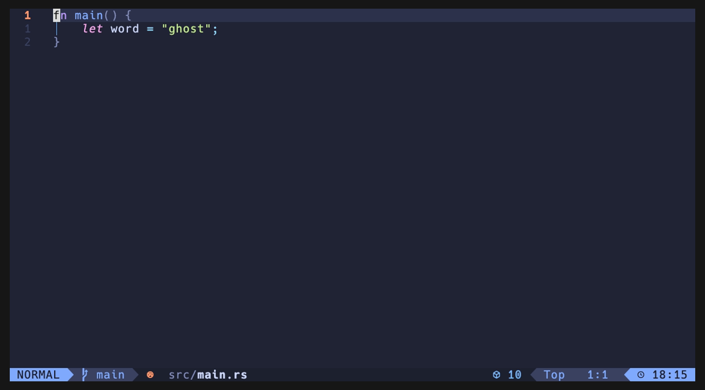

# ghost.nvim

Learn to code by hand without leaving the editor to look things up.

Write a question as a comment that starts with `?`. A read-only answer appears
under it as ghost text: either the code to write, or a few short steps when the
answer isn't code. You type it in yourself.



```rust
// ? read the file named by the first argument into a String, exit with a message if it fails
┆ let path = args.get(1).unwrap_or_else(|| {
┆     eprintln!("usage: demo <file>");
┆     std::process::exit(1);
┆ });
┆ let contents = std::fs::read_to_string(path).unwrap_or_else(|e| {
┆     eprintln!("can't read {path}: {e}");
┆     std::process::exit(1);
┆ });
```

```lua
-- ? split the window to the right and jump back and forth
┆ Press <Space>| to split the window right.
┆ Press <C-L> to jump to the right split, <C-H> to jump back.
┆ (These are Neovim splits; tmux panes use prefix C-a then h/j/k/l.)
```

The second answer uses **your** keybindings. ghost reads your live Neovim
keymaps, tmux bindings and shell aliases, so it says `<Space>|` and `C-a`, not
the textbook defaults.

## What it is, and what it isn't

- **Not autocomplete.** It never inserts anything into your file. The ghost
  text isn't part of the buffer: you can't edit it, and it's never saved.
- **Not a chat.** You ask with a comment and get one answer back. There's no
  conversation and no follow-up.
- **Remembered.** Answers are cached next to your code in `.ghost/`, so
  reopening a file shows them again without another request.
- **Also works from the terminal.** `ghost "how do I attach to my tmux session"`
  answers using the same setup context, for when you're not in a file (see
  [Shell command](#shell-command)).
- **Uses the AI CLI you already have.** Answers come from
  [Claude Code](https://github.com/anthropics/claude-code) or the
  [Codex CLI](https://github.com/openai/codex) (or any CLI you configure),
  using that tool's existing login. There are no API keys to manage.

## Requirements

- Neovim 0.10 or newer
- One of:
  - `claude` (Claude Code), logged in. This is the default.
  - `codex` (Codex CLI), logged in
  - any CLI that reads a prompt on stdin (see [Backends](#backends))
- Optional:
  - `tmux`, for answers that use your tmux bindings
  - Treesitter parsers, for syntax-highlighted ghost code

## Installation

[lazy.nvim](https://github.com/folke/lazy.nvim):

```lua
{
  "mrwatts88/ghost.nvim",
  event = "VeryLazy",
  opts = {},
}
```

Neovim 0.12's built-in `vim.pack`:

```lua
vim.pack.add({ "https://github.com/mrwatts88/ghost.nvim" })
require("ghost").setup({})
```

Then run `:checkhealth ghost`.

## Usage

1. Write a comment whose text starts with `?`. Any comment style works:
   `// ?`, `# ?`, `-- ?`, `; ?`, `/* ? */`, `<!-- ? -->`. A long question can
   continue on the comment lines directly below it.
2. Put the cursor on it and press `<leader>ii`.
3. `⋯ thinking` shows while it works. The answer replaces it a few seconds later.

| Key | Command | What it does |
| --- | --- | --- |
| `<leader>ii` | `:Ghost ask` | Ask the question under the cursor (shows the saved answer if there is one) |
| `<leader>ia` | `:Ghost all` | Ask every question in the file that has no answer yet |
| `<leader>ir` | `:Ghost regenerate` | Ask again and replace the saved answer |
| `<leader>it` | `:Ghost toggle` | Hide or show answers in this buffer, to quiz yourself |
| `<leader>ie` | `:Ghost expand` | Expand answers longer than `max_lines` |
| | `:Ghost setup` | Open the setup context that gets sent with questions |

Answers follow their question. They're keyed by the question's text and the
file's language, not by line or file. You can move a comment anywhere in the
project and its answer comes with it, with no new request. The same question in
a Rust file and a Python file gets two separate answers. Edit the question and
it counts as a new one.

## Configuration

These are the defaults. Pass only what you want to change.

```lua
require("ghost").setup({
  -- "claude", "codex", or { cmd = { ... } } for any other CLI (see Backends)
  backend = "claude",
  -- Passed through to the CLI. nil = the CLI's default
  -- (claude: "sonnet"; codex: your ~/.codex/config.toml)
  model = nil,
  -- claude: low | medium | high | xhigh | max
  -- codex:  minimal | low | medium | high
  effort = nil,
  -- Extra flags appended to the built-in backend's command
  args = {},
  -- Path to the CLI, if it isn't on $PATH under the backend's name
  cmd = nil,

  -- Ask every unanswered question in the file on :w (like <leader>ia)
  ask_on_save = false,
  max_lines = 30,
  timeout_ms = 90000,

  -- Set to false and map require("ghost").ask / .ask_all / .regenerate /
  -- .toggle / .expand yourself
  keys = {
    ask = "<leader>ii",
    ask_all = "<leader>ia",
    regenerate = "<leader>ir",
    toggle = "<leader>it",
    expand = "<leader>ie",
  },

  -- What "your setup" context is sent with each question
  context = {
    nvim = true, -- keymaps that have a description
    tmux = true, -- effective tmux bindings, plus your tmux.conf
    -- "aliases": only alias / function / bindkey lines from shell_files,
    --            each with the comment directly above it
    -- "full":    the whole files
    -- false:     nothing
    shell = "aliases",
    shell_files = { "~/.zshrc", "~/.bashrc", "~/.config/fish/config.fish" },
  },
})
```

### Backends

Every backend runs **read-only**. Claude Code runs with all tools disabled,
and Codex runs in its `read-only` sandbox. An answer can never change your
files.

```lua
-- Claude Code (default). A cheaper, faster model:
opts = { model = "haiku" }

-- Codex CLI, with your configured model and low reasoning effort
opts = { backend = "codex", effort = "low" }

-- Anything else: ghost writes the prompt to stdin and looks for a JSON
-- object { "kind", "lang", "body" } in stdout. model/effort/args are
-- ignored here; put those flags in cmd yourself.
opts = { backend = { cmd = { "my-llm", "--model", "some-model" } } }
```

## Privacy: what gets sent

Every question sends this to your backend:

- the question, and about 60 lines of code around it
- the nearest project manifest (`Cargo.toml`, `package.json`, `pyproject.toml`, …),
  so answers match your dependency versions
- the setup context: your Neovim keymaps, your tmux bindings and `tmux.conf`,
  and your shell aliases, as set by `context`

The default shell mode, `"aliases"`, only sends the lines that define
aliases, functions and key bindings, because rc files are where people tend to
`export` tokens. Run `:Ghost setup` to see exactly what's sent, and set any
part of `context` to `false` to leave it out.

## The `.ghost/` folder

Answers are stored in one file per project, `<git root>/.ghost/answers.json`.
It has sorted keys and one field per line, so it diffs cleanly. **Committing it
is encouraged:** it becomes a notebook of how-tos for the project, readable top
to bottom. If you'd rather not, add `.ghost/` to `.gitignore`. Files outside a
git repo share a store in Neovim's cache directory instead.

Each answer lists the files that ask its question. When you save a file, that
file is taken off the list of every answer whose question it no longer has, and
an answer no file asks anymore is deleted. Projects using the older layout (one
`.ghost/<path>.json` per source file) are converted automatically the first time
you open them.

## Shell command

`bin/ghost` asks a question from the terminal. It loads your Neovim config
headless, so answers still use your keybindings and aliases. It prints the
answer and saves nothing.

Put it on your `$PATH` by linking it from wherever your plugin manager
installed ghost.nvim:

```sh
# lazy.nvim
ln -s ~/.local/share/nvim/lazy/ghost.nvim/bin/ghost ~/.local/bin/ghost
# vim.pack
ln -s ~/.local/share/nvim/site/pack/core/opt/ghost.nvim/bin/ghost ~/.local/bin/ghost
```

```sh
ghost "how do I attach to my tmux session"
GHOST_BACKEND=codex GHOST_EFFORT=low ghost "undo the last git commit but keep the changes"
```

Quote questions that contain `?`. Otherwise zsh treats `?` as a wildcard.

## Highlights

| Group | Default | Used for |
| --- | --- | --- |
| `GhostText` | links to `Comment` | step answers, the "thinking" line |
| `GhostCode` | `italic` | layered on syntax colors in code answers |
| `GhostBar` | links to `NonText` | the `┆` gutter |
| `GhostError` | links to `DiagnosticError` | failed requests |

Code answers are syntax-highlighted with treesitter whenever a parser for the
language is installed. Otherwise they're shown as `GhostText`.

## Cost

Each question is one request. It carries a few thousand tokens of setup
context, plus your question and the code around it. That counts against your
Claude or ChatGPT plan, or your API usage, the same as any other request from
those tools. Cached answers cost nothing.

## Contributing

See [CONTRIBUTING.md](CONTRIBUTING.md).

## License

[MIT](LICENSE)
